<p align="center">
  
</p>

<h1 align="center">Query2Table</h1>

<p align="center"><a href="../../README.md">English</a> · <a href="README.ru.md">Русский</a> · <a href="README.de.md">Deutsch</a> · <a href="README.fr.md">Français</a> · <a href="README.es.md">Español</a> · <a href="README.it.md">Italiano</a> · <a href="README.pt.md">Português (Brasil)</a> · <a href="README.pl.md">Polski</a> · <b>Українська</b> · <a href="README.tr.md">Türkçe</a> · <a href="README.zh.md">简体中文</a> · <a href="README.ja.md">日本語</a> · <a href="README.ko.md">한국어</a></p>

<p align="center">
  <a href="https://github.com/hightemp/query2table/releases/latest"></a>
  <a href="https://github.com/hightemp/query2table/releases"></a>
  <a href="#ліцензія"></a>
  <a href="https://v2.tauri.app/"></a>
  <a href="https://www.rust-lang.org/"></a>
  <a href="https://svelte.dev/"></a>
  <br>
  
</p>

**Query2Table** — локальний дослідницький інструмент для комп’ютера (Linux, Windows, macOS) і Android. Ви описуєте, які дані вам потрібні, а застосунок самостійно шукає в інтернеті за багатьма джерелами й мовами, завантажує сторінки, вилучає структуровані об’єкти за допомогою LLM, видаляє дублікати й показує результат у таблиці, що оновлюється в реальному часі, з посиланнями на джерела для кожного рядка. Усе працює на вашому комп’ютері, без хмарного бекенда.

Крім таблиць, є ще три окремі режими: **пошук зображень**, який знаходить зображення й ранжує їх за допомогою LLM за візуальною релевантністю; **пошук посилань**, який читає повний вміст сторінок-кандидатів і повертає лише найрелевантніші посилання з описами й оцінками релевантності від LLM; і **дослідження** — агентний режим, у якому модель самостійно шукає, читає сторінки, міркує й пише відповідь у Markdown із джерелами.

Застосунок доступний і для телефонів на **Android**: той самий застосунок з тими самими режимами, налаштуваннями та історією, зібраний з того самого коду й пристосований до екрана телефона з нижньою панеллю вкладок.

Попросіть, наприклад, *«Склади порівняльну таблицю векторних баз даних і бібліотек для пошуку з відкритим кодом: мова, ліцензія, тип розгортання, сценарій використання та сайт»* — і дивіться, як таблиця заповнюється в реальному часі.

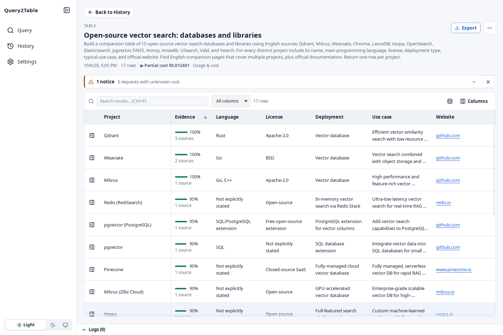

## Огляд

### Запитуйте звичайною мовою

Виберіть формат результату, опишіть, що вам потрібно, і задайте умови зупинки. Для таблиць застосунок пропонує стовпці, які можна змінити до початку пошуку.

<table>
  <tr>
    <td>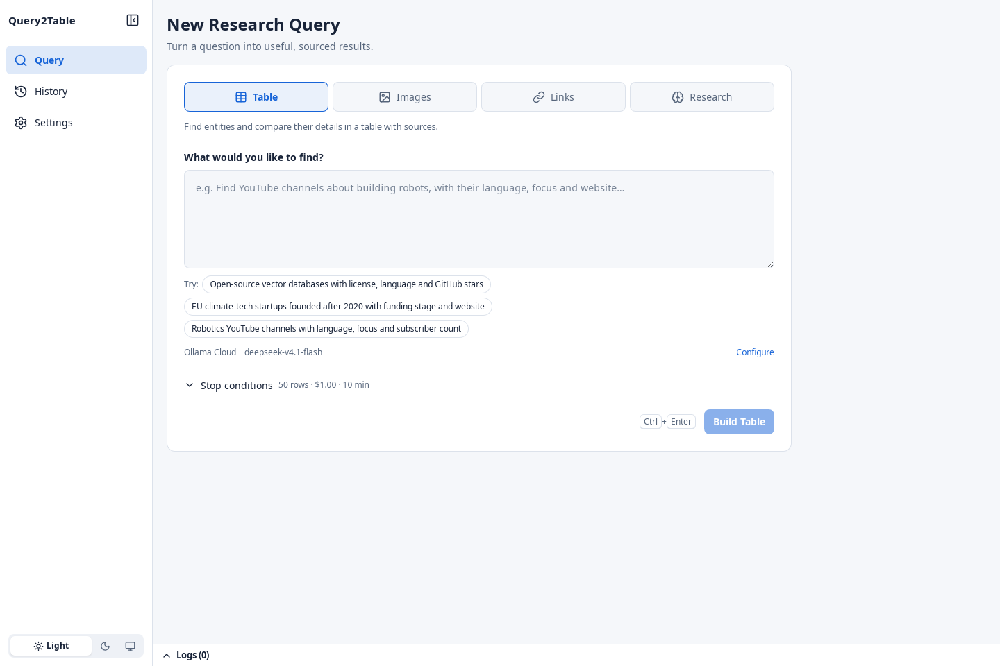</td>
    <td>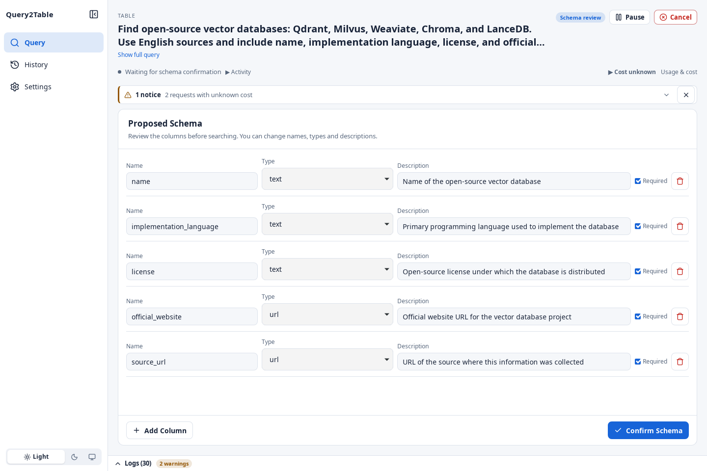</td>
  </tr>
</table>

### Кожен рядок зберігає свої підтвердження

Відкрийте рядок, щоб прочитати значення повністю, скопіювати їх і перевірити сторінки, з яких їх вилучено.

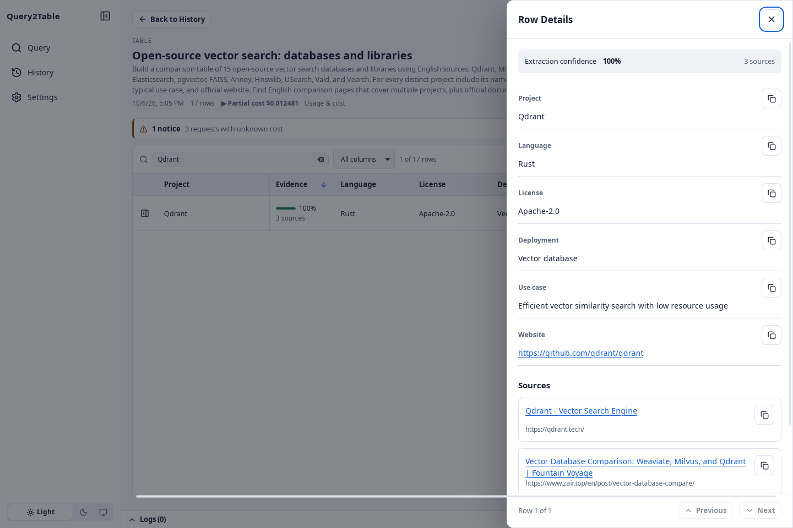

### Дослідження з уточнювальними запитаннями

Агент шукає, читає сторінки й пише відповідь із джерелами та змістом. Кожен крок видно у вкладці «Хід роботи», а уточнювальні запитання продовжують розмову з урахуванням її історії.

<table>
  <tr>
    <td>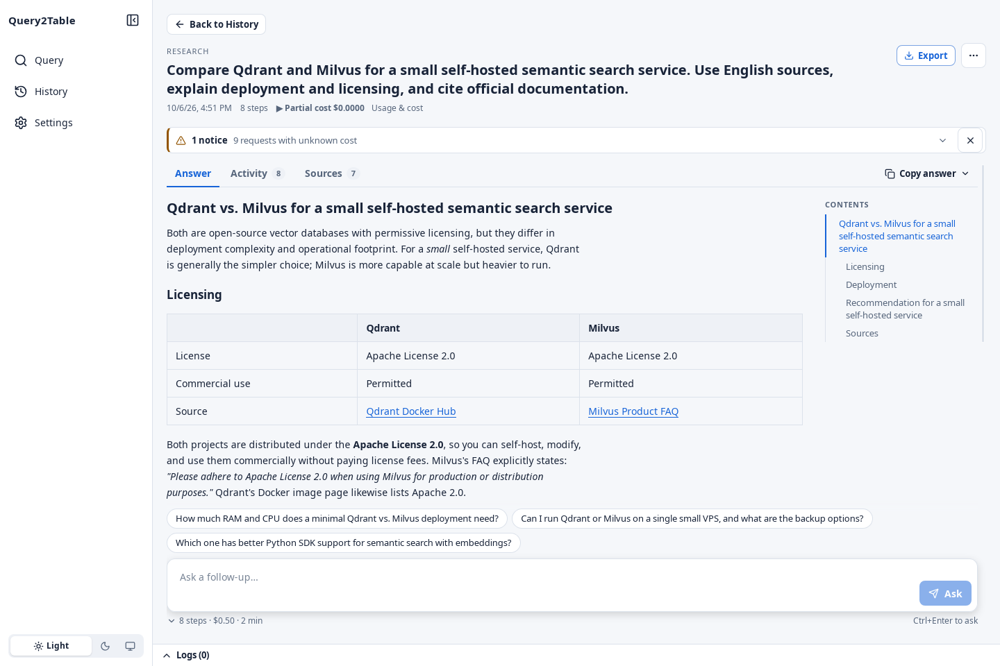</td>
    <td>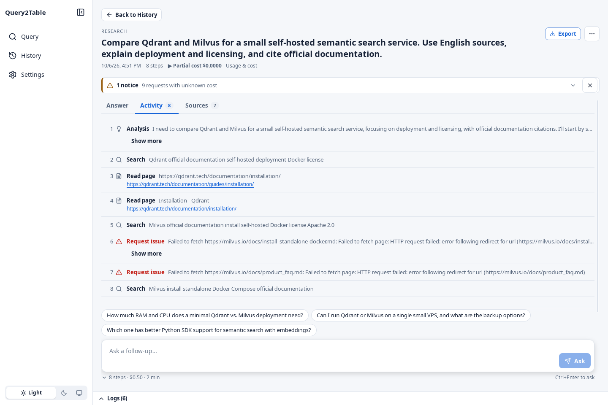</td>
  </tr>
</table>

### Зображення й посилання

Пошук зображень ранжує результати за релевантністю й має фільтри за сайтом і розміром; пошук посилань читає кожну сторінку й пояснює, чому вона підходить.

<table>
  <tr>
    <td>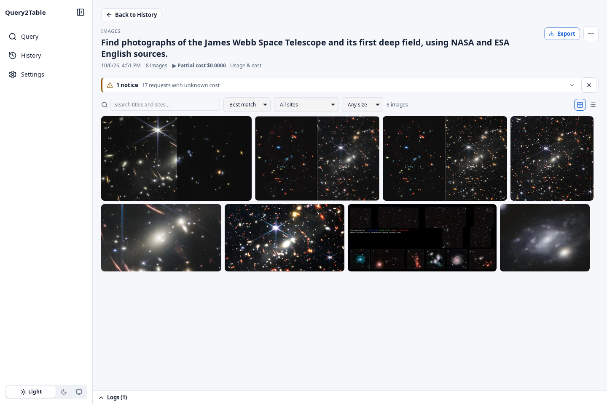</td>
    <td>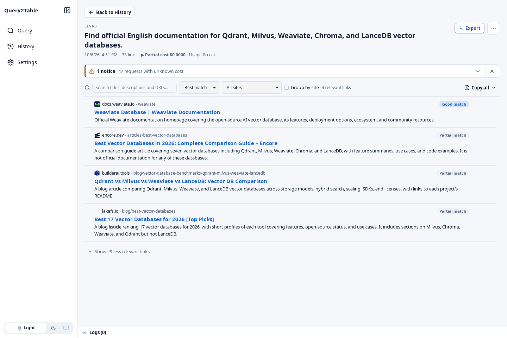</td>
  </tr>
</table>

### Історія й налаштування

Шукайте, фільтруйте й знову відкривайте минулі запуски, повторюйте їх або експортуйте кілька одразу. Налаштування перевіряють підключення до LLM і пошуку ще до початку роботи.

<table>
  <tr>
    <td>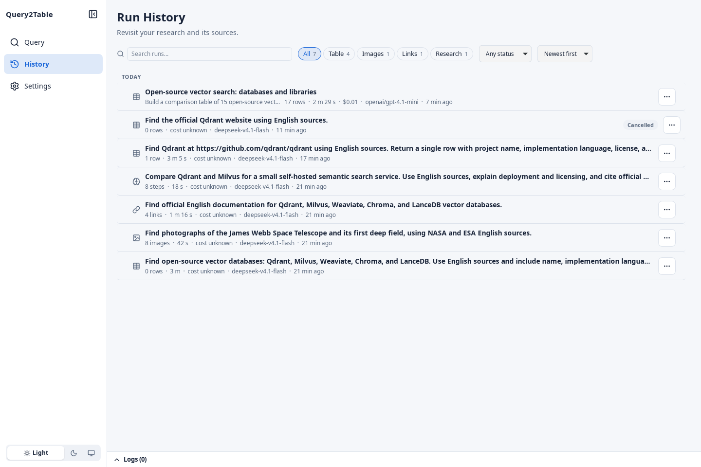</td>
    <td>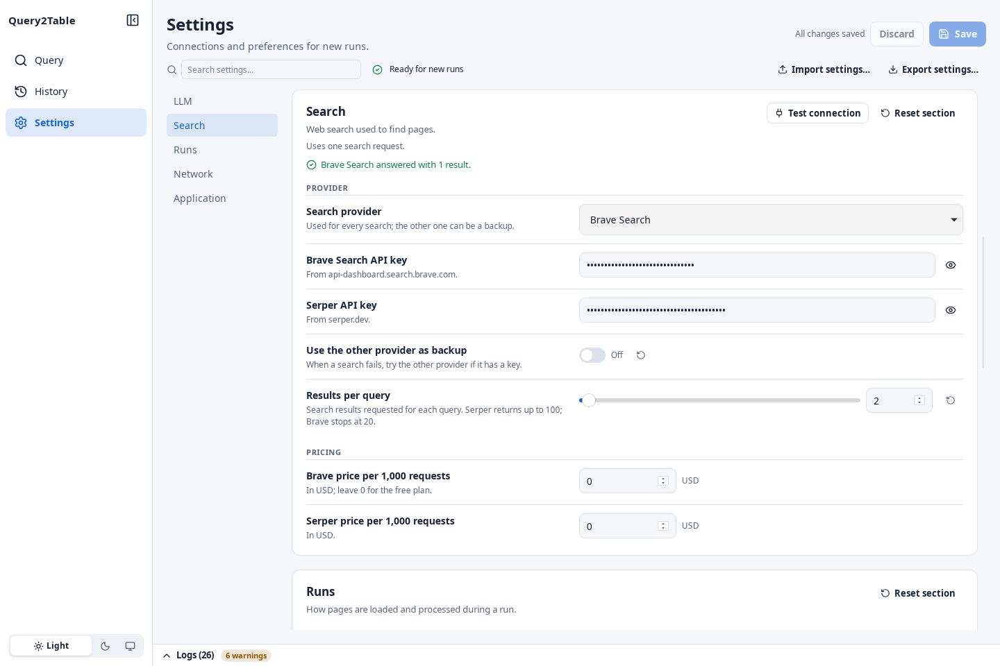</td>
  </tr>
</table>

### Світла й темна теми

<table>
  <tr>
    <td>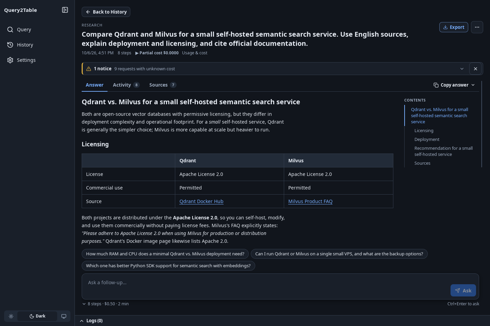</td>
    <td>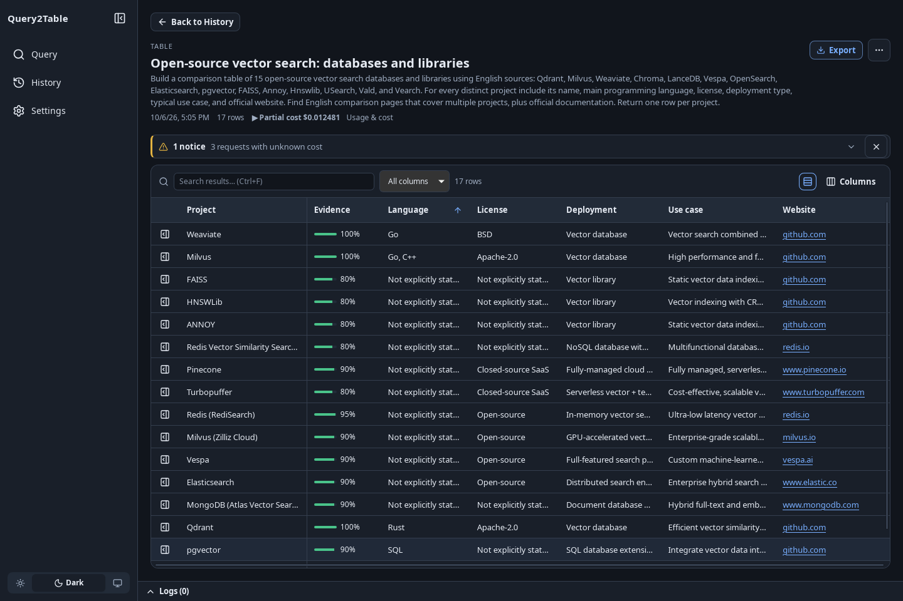</td>
  </tr>
</table>

## Завантаження

Останню збірку можна отримати в розділі [Releases](https://github.com/hightemp/query2table/releases/latest):

| Платформа | Файл |
|-----------|------|
| Linux | `.AppImage`, `.deb`, `.rpm` |
| Windows | `.msi`, `.exe` |
| macOS (Apple Silicon) | `.dmg` |
| Android 7.0+ | `Query2Table_<version>_android.apk` |

Щоб перенести налаштування з комп’ютера на телефон, скористайтеся **Налаштування → Експортувати налаштування…**, позначте **Включити ключі API та проксі** й імпортуйте файл на телефоні. Такий файл містить ваші ключі: зберігайте його в таємниці й видаліть після імпорту.

На Android відкрийте завантажений APK і, коли система попросить, дозвольте встановлення застосунків із браузера або файлового менеджера. Застосунок для Android зберігає дані на телефоні; системного трею в ньому немає, сповіщення показуються як звичайні сповіщення Android. Локальні сервери моделей (Ollama, llama.cpp) можна використовувати через мережу за їхньою адресою, наприклад `http://192.168.1.10:11434`.

## Можливості

- **Запити природною мовою** — опишіть, що вам потрібно, звичайними словами
- **Автоматичне визначення схеми** — застосунок пропонує стовпці таблиці; ви підтверджуєте або змінюєте їх перед виконанням
- **Пошук через кількох провайдерів** — Brave Search + Serper з автоматичним резервуванням
- **Багатомовне розширення запитів** — пошук різними мовами й у різних регіонах
- **Вилучення за допомогою LLM** — OpenRouter, Anthropic Claude (кешування промптів, за бажанням — читання PDF цілком), Ollama (локально або Cloud), DeepSeek, Groq, Mistral, Gemini, xAI, OpenAI, LM Studio, llama.cpp або будь-яка адреса, сумісна з OpenAI
- **Потокові результати** — рядки з’являються в таблиці щойно їх знайдено
- **Вилучення з PDF** — автоматично розпізнає PDF-документи в результатах пошуку й вилучає з них текст
- **Режим пошуку зображень** — окремий конвеєр, що шукає зображення замість тексту: генерує 6–12 різних варіантів запиту (за допомогою LLM або статичних запасних варіантів), виконує пошук зображень через Brave / Serper, а потім оцінює кожен результат за допомогою LLM за суворою шкалою релевантності (0.0–1.0); зображення з оцінкою нижче 0.7 відкидаються, решта зберігаються, відсортовані за оцінкою, з оновленням інтерфейсу для кожного зображення в реальному часі; бюджет, скасування й умови зупинки (кількість / вартість / час) враховуються на всіх етапах
- **Режим пошуку посилань** — окремий конвеєр, що повертає найрелевантніші сторінки замість таблиці: генерує варіанти пошукових запитів із вашого запиту, виконує вебпошук через Brave / Serper (з усуненням дублікатів за URL), завантажує й розбирає кожну сторінку, після чого LLM читає повний вміст, оцінює його релевантність вашому запиту (0.0–1.0) і пише короткий опис; сторінки нижче порогу впевненості відкидаються, решта зберігаються, відсортовані за оцінкою, з оновленням інтерфейсу для кожного посилання в реальному часі; бюджет, скасування й умови зупинки враховуються на всіх етапах
- **Режим дослідження** — агентний режим, що відповідає на відкриті запитання текстом у Markdown замість таблиці: LLM керує циклом виклику інструментів (пошук в інтернеті, завантаження сторінки як Markdown, міркування, відповідь) упродовж фіксованої кількості кроків і передає кожен крок на живу часову шкалу; кроки міркувань (`think`) і будь-які збої (кроки `error`, позначені червоним) показуються, тож процес лишається прозорим, а підсумкова відповідь у Markdown із джерелами відображається (після очищення) і експортується як `.md`; бюджет, скасування й умови зупинки враховуються на всіх етапах
- **Формули й картинки у відповідях дослідження** — формули LaTeX відображаються (MathJax, без інтернету); агент може шукати зображення, переглядати їх і вставляти відповідні у відповідь, вони зберігаються разом із запуском
- **Діаграми й графіки у відповідях дослідження** — діаграми Mermaid і стовпчикові, лінійні, з областями, кругові, точкові, пелюсткові діаграми й теплові карти, що малюються без інтернету в темі застосунку; їх можна зберегти як SVG або PNG і відкрити на весь екран
- **Відео у відповідях дослідження** — агент знаходить відео на будь-яких сайтах (вебпошук відео або напряму YouTube, Bilibili, Niconico і SoundCloud), читає їхні субтитри з мітками часу й посилається на потрібні моменти; відео показуються картками зі збереженими обкладинками. Працює через yt-dlp, який завантажується під час першого використання (на Android — із вбудованим Python)
- **Статистика використання** — гроші, токени, виклики моделей, пошуки Brave і Serper та обсяг даних за місяць, рік і весь час, з розбивкою за моделями й режимами, найдорожчими запусками, використанням диска, експортом у CSV і місячним бюджетом із попередженнями
- **13 мов інтерфейсу** — англійська, російська, німецька, французька, іспанська, італійська, португальська (Бразилія), польська, українська, турецька, китайська (спрощена), японська й корейська; типово вибирається мова системи
- **Джерела для кожного рядка** — кожен рядок посилається на сторінки, з яких його вилучено
- **Усунення дублікатів** — нечітке порівняння + уточнення за допомогою LLM
- **Налаштовувані умови зупинки** — потрібна кількість рядків, макс. вартість, макс. тривалість
- **Історія запусків** — переглядайте й повторно експортуйте минулі дослідження
- **Експорт** — CSV, JSON, XLSX з повними метаданими джерел
- **Темна / світла тема** — перемикач на бічній панелі
- **Системний трей** — сповіщення про завершення (на комп’ютері)
- **Застосунок для Android** — той самий застосунок на телефонах, з макетом для малих екранів
- **Оновлення із застосунку** — про нові версії повідомляється разом зі списком змін, а встановлюються вони із застосунку після перевірки підпису (на комп’ютері й Android)
- **Локальність** — усі дані в SQLite, хмарний бекенд не потрібен

## Технології

| Рівень | Технологія |
|--------|------------|
| Оболонка застосунку | Tauri v2 (комп’ютер і Android) |
| Бекенд | Rust (асинхронне середовище Tokio) |
| Фронтенд | Svelte 5 (SvelteKit SPA) |
| Стилі інтерфейсу | Звичайний CSS із токенами дизайну |
| База даних | SQLite (sqlx, режим WAL) |
| LLM | OpenRouter / Ollama (локально) / Ollama Cloud / API, сумісний з OpenAI (напр. llama.cpp) |
| Пошук | Brave Search API / Serper API |
| Значки | Lucide |

## Вимоги

- [Node.js](https://nodejs.org/) >= 18
- [Rust](https://www.rust-lang.org/tools/install) (стабільний тулчейн)
- [Вимоги Tauri v2](https://v2.tauri.app/start/prerequisites/) для вашої ОС

## Початок роботи

```bash
# Clone the repository
git clone https://github.com/hightemp/query2table.git
cd query2table

# Install frontend dependencies
npm install

# Run in development mode (starts both Vite dev server and Tauri)
npm run tauri dev

# Build for production
npm run tauri build
```

## Налаштування

Під час першого запуску застосунок створює локальну базу даних SQLite з типовими налаштуваннями. Відкрийте **Налаштування** на бічній панелі, щоб налаштувати:

| Група | Параметри |
|-------|-----------|
| **Провайдер LLM** | Провайдер (OpenRouter / Ollama / Ollama Cloud / сумісний з OpenAI), URL, модель, ключ API, режим JSON, температура, макс. токенів |
| **Провайдер пошуку** | Провайдер (Brave / Serper), ключ API, перемикач резервного провайдера, результатів на запит |
| **Виконання** | Паралельні завантаження (типово 8), паралельні вилучення (типово 3), тайм-аут завантаження, обмеження частоти запитів, robots.txt |
| **Якість** | Баланс точності й повноти, суворість підтверджень, поріг упевненості, схожість дублікатів |

Умови зупинки (потрібна кількість рядків, макс. вартість, макс. тривалість) задаються для кожного запиту на сторінці «Запит».

**Інший провайдер як резервний** керує автоматичним перемиканням між Brave і Serper як для вебпошуку, так і для пошуку зображень. Вимкніть його, щоб використовувати лише вибраного основного провайдера, навіть якщо збережено обидва ключі API. Вибір застосовується до нових запусків після збереження; повторні спроби залишаються з вибраним провайдером. Якщо параметр увімкнено, інший провайдер використовується лише після збою і потребує збереженого ключа.

Укажіть **Налаштування → Пошук → Результатів на запит**, щоб вибрати, скільки результатів запитує кожен пошуковий запит у всіх чотирьох режимах, зокрема в «Дослідженні», а потім збережіть для нових запусків. Запити до Brave обмежують це значення задокументованим діапазоном кінцевої точки: [1–20 для вебпошуку](https://api-dashboard.search.brave.com/api-reference/web/search/get) і [до 200 для зображень](https://api-dashboard.search.brave.com/documentation/services/image-search). Це стосується й раніше збережених завеликих значень. Більші значення не вмикають автоматичного запиту додаткових сторінок.

### Використання, ціни й ліміти витрат

**Використання й вартість** розрізняє витрати, повідомлені провайдером, оцінки за тарифами моделей, часткові суми та невідомі витрати. Кожна спроба звернення до провайдера рахується окремо, зокрема повторні спроби, резервні пошуки, невдалі відповіді з даними про використання та скасовані запити, остаточну вартість яких отримати не вдалося. Дані про вхідні й вихідні токени беруться з відповідей провайдерів; токени міркувань не оплачуються вдруге понад вихідні токени.

- **OpenRouter:** перевага надається [повідомленій вартості запиту](https://openrouter.ai/docs/cookbook/administration/usage-accounting). Якщо її немає, вартість оцінюється за повідомленими токенами й публічними тарифами з каталогу для моделі, яка фактично відповіла.
- **Ollama Cloud:** витрачання кредитів оцінюється за [опублікованими тарифами моделей](https://ollama.com/pricing), зокрема для кешованих вхідних токенів і розпізнаних періодів пікових цін. Включені кредити, оплата підписки й грошові платежі можуть відрізнятися від цієї оцінки. Нерозпізнані або недоступні тарифи лишаються невідомими.
- **Власні тарифи моделей:** укажіть у налаштуваннях ціни вхідних і вихідних токенів у USD за мільйон. Тарифи належать конкретному провайдеру, адресі й моделі. Явний нуль означає безкоштовне використання; відсутні тарифи ніколи непомітно не стають нулем. Опубліковані тарифи завантажуються без зміни збережених вручну.
- **Пошук:** для Brave і Serper типова ціна — 0 USD за 1 000 запитів, тож витрати на пошук не входять в оцінки. Щоб їх урахувати, укажіть фактичну ціну свого тарифу або залиште поле порожнім, якщо ціна невідома. Невдалі спроби без даних про оплату лишаються без ціни. Зміни налаштувань застосовуються до нових запусків; збережена історія не перераховується. Під час оновлення колишні порожні типові значення один раз стають нулем, а наявні числові тарифи й пізніші навмисно порожні поля зберігаються.

**Макс. вартість** запуску не дає надсилати нові запити до провайдерів, щойно врахована сума витрат досягає ліміту. Це не гарантована верхня межа рахунку: оцінки можуть відрізнятися від фактичної оплати, невідомі витрати неможливо врахувати, а за запити, що вже виконуються, усе ще можуть стягнути плату. Якщо потрібен суворий ліміт, налаштуйте обмеження на боці провайдера. Облік зберігається для завершених, невдалих, скасованих запусків і запусків без результатів. Давніші записи історії явно позначено як історичні оцінки.

Під час усунення дублікатів зберігається ID рядка першого учасника групи, значення й записи джерел групи об’єднуються в одній транзакції, а жива таблиця узгоджується з історією та експортом. Раніше перезаписані історичні результати автоматично відновити неможливо; щоб отримати свіжі результати, повторіть ці запити.

Кнопки **Зберегти** та **Скасувати зміни** в налаштуваннях лишаються видимими під час прокручування. Посилання на розділи ведуть прямо до потрібних елементів, а якщо ви виходите з незбереженими змінами, застосунок пропонує «Зберегти» / «Скасувати зміни» / «Залишитися». Зміни, зроблені під час збереження, лишаються доступними для наступного збереження.

Результати показуються в суцільній віртуалізованій таблиці з локальним пошуком і сортуванням із клавіатури. Відкрийте **Подробиці** рядка, щоб прочитати або скопіювати значення повністю й переглянути збережені джерела. У «Дослідженні» відповідь іде перед розгортаним ходом роботи. Для зображень є вигляд сіткою чи списком і перегляд із клавіатури; експорт і видалення явно показують хід і результат. Очищення діагностичної панелі **Журнал** не скидає ходу роботи запуску.

Регресійні перевірки в браузері використовують синтетичні дані й імітовані команди Tauri: установіть тестові браузери командою `npx playwright install chromium webkit`, потім виконайте `npm run test:ui`. Наявні тести фронтенду запускаються командою `npm test`.

### Ключі API

Потрібен щонайменше один ключ API пошуку й налаштований провайдер LLM. Локальний Ollama і сервери, сумісні з OpenAI, без автентифікації не потребують ключа API для LLM:

| Сервіс | Де отримати ключ |
|--------|------------------|
| Brave Search | https://brave.com/search/api/ |
| Serper | https://serper.dev/ |
| OpenRouter | https://openrouter.ai/ |
| Ollama (локально) | https://ollama.com/ — ключ не потрібен |
| Ollama Cloud | https://ollama.com/settings/keys |
| Сумісний з OpenAI | Ключ необов’язковий, залежно від вашого сервера |

Виберіть провайдера в **Налаштування → Провайдер LLM**, заповніть його поля й натисніть **Зберегти**. Під час перемикання кожен провайдер зберігає власну модель і облікові дані.

Міграції налаштувань виконуються автоматично під час запуску застосунку: нові параметри отримують типові значення, а наявні зберігаються. Перейменовані налаштування явно переносяться в бекенді до вставлення типових значень; зміни у форматах зберігання під час реалізації нової версії також потребують коду міграції.

Унизу сторінки **Налаштування** розділ **Файли застосунку** показує фактичну папку даних, базу даних `data.db` і папку журналів. Натисніть **Копіювати шлях**, щоб скопіювати розташування в системний буфер обміну, або **Відкрити папку**, щоб відкрити його у файловому менеджері. Для бази даних відкривається папка, у якій вона лежить. Налаштування, історія, результати й джерела зберігаються в `data.db`; діагностичні журнали зберігаються окремо.

- **OpenRouter:** введіть ключ API й виберіть модель із [каталогу OpenRouter](https://openrouter.ai/docs/api/api-reference/models/list-all-models-and-their-properties) з пошуком. Вводьте текст, щоб відфільтрувати ID моделей, вибирайте мишею або клавішами зі стрілками й Enter, а кнопка **Оновити** перезавантажує список. Каталог можна переглядати ще до введення ключа; для генерації ключ обов’язковий.
- **Ollama (локально):** URL `http://localhost:11434` і назва встановленої моделі.
- **Ollama Cloud:** URL `https://ollama.com`, ключ API Ollama й модель, вибрана з каталогу сервера з пошуком. Клацніть поле моделі й вводьте текст для фільтрації, потім виберіть мишею або клавішами зі стрілками й Enter; **Оновити** перезавантажує каталог. Фільтрація не змінює вибраної моделі, доки ви не виберете результат. Прямий доступ до хмари використовує [власний API Ollama](https://docs.ollama.com/cloud). Хмара наразі не має [підтримки структурованого виводу](https://docs.ollama.com/capabilities/structured-outputs), тому JSON запитується через промпти й розбирається наявним конвеєром.
- **Сумісний з OpenAI:** введіть базову URL-адресу API разом із `/v1` та ID моделі на сервері. Для [llama.cpp](https://github.com/ggml-org/llama.cpp/tree/master/tools/server) типова URL-адреса — `http://localhost:8080/v1`; укажіть назву завантаженої моделі або налаштований псевдонім. Залиште ключ API порожнім, якщо ваш сервер його не вимагає. Вимкніть **Режим JSON**, якщо сервер відхиляє `response_format`.

**Міркування** керують тим, скільки модель міркує перед відповіддю. **Авто** зберігає безпечні типові значення: для структурованих запитів Ollama міркування вимикаються (GPT-OSS використовує «Низький»), а інші провайдери зберігають свої типові значення. **Типово для провайдера** залишає міркування на розсуд сервера. **Вимк.**, **Увімк.**, **Низький**, **Середній**, **Високий** і **Макс.** запитують явний режим або рівень; підтримка залежить від моделі й провайдера. GPT-OSS в Ollama приймає «Низький» / «Середній» / «Високий» і не може використовувати «Вимк.» чи «Макс.». Зміни застосовуються до нових запусків після збереження.

**Макс. вихідних токенів** — ліміт на один запит, який можуть ділити між собою токени міркувань і відповіді. Він не залежить від лімітів вартості й часу запуску та від квоти облікового запису провайдера. Що інтенсивніші міркування, то менше токенів може лишитися на відповідь.

Проблеми із запитами до моделі показують провайдера, модель, етап, запитаний ліміт виводу, повідомлену кількість вхідних, вихідних токенів і токенів міркувань, а також те, чи заплановано повторну спробу. Ліміти виводу, ліміти контексту, квоти провайдера, обмеження частоти, помилки автентифікації й мережі мають окремі пояснення та способи виправлення. Проблеми лишаються видимими, коли окремі сторінки пропускаються, і доступні в «Історії запусків». Інші помилки показують коротке пояснення, дію, яку варто виконати, і технічні подробиці, що розгортаються.

**Призупинити** зупиняє обробку на поточному етапі, зокрема під час перегляду схеми, а **Продовжити** відновлює роботу без повторного надсилання запиту. Запит, уже надісланий віддаленій моделі, може завершитися там і під час паузи. **Скасувати** зупиняє локальну роботу й закриває запити, що очікують. Збої конвеєра показуються й зберігаються зі статусом `failed`, а вихідна помилка доступна в журналі запуску.

## Архітектура

Бекенд використовує **скінченний автомат конвеєра** з фіксованими ролями, що виконуються послідовно:

```
Query → Interpret → Plan Schema → [User Confirms] → Plan Searches
      → Expand Queries → Execute Search → Fetch Pages → Parse Documents
      → Extract Entities → Validate → Deduplicate → [Stop Check] → Done
```

### Ролі конвеєра

| Роль | LLM | Призначення |
|------|-----|-------------|
| QueryInterpreter | Так | Перетворює запит на структурований намір |
| SchemaPlanner | Так | Пропонує стовпці таблиці та їхні типи |
| SearchPlanner | Так | Генерує пошукові запити для кількох мов і регіонів |
| QueryExpander | Так | Перекладає запити цільовими мовами |
| SearchExecutor | Ні | Викликає API пошуку, збирає URL-кандидати |
| Fetcher | Ні | Завантаження HTTP з обмеженням частоти й robots.txt |
| DocumentParser | Ні | HTML → чистий текст (видалення шаблонних частин) |
| PdfParser | Ні | PDF → чистий текст (через pdf-extract) |
| Extractor | Так | Текст + схема → структуровані рядки |
| Validator | Частково | Відповідність схемі + смислові перевірки |
| Deduplicator | Частково | Нечітке порівняння (strsim) + LLM для складних випадків |
| LinkRanker | Так | Читає вміст сторінки, оцінює релевантність (0.0–1.0) + пише опис (режим пошуку посилань) |
| ResearchAgent | Так | Веде агентний цикл пошуку / завантаження / міркування / відповіді й створює відповідь у Markdown (режим дослідження) |
| StoppingController | Ні | Перевіряє умови зупинки (рядки, бюджет, час, насичення) |

### Скінченний автомат

```
Pending → SchemaReview → Running ⇄ Paused → Completed / Failed / Cancelled
```

## Структура проєкту

```
query2table/
├── src-tauri/               # Rust backend
│   ├── src/
│   │   ├── main.rs          # Tauri entry point
│   │   ├── commands/        # IPC command handlers
│   │   ├── orchestrator/    # Pipeline state machine, budget tracker
│   │   ├── roles/           # Pipeline & research-agent roles
│   │   ├── providers/       # External API clients (LLM, search, HTTP)
│   │   ├── storage/         # SQLite models & repository
│   │   └── export/          # CSV, JSON, XLSX export
│   └── migrations/          # SQLite schema migrations
├── src/                     # Svelte frontend
│   ├── lib/
│   │   ├── components/      # UI components
│   │   ├── stores/          # Svelte stores (run, settings, ui, logs)
│   │   ├── types/           # TypeScript type definitions
│   │   └── api/             # Tauri invoke/listen wrappers
│   └── routes/              # Pages (query, history, settings)
├── package.json
└── src-tauri/Cargo.toml
```

## База даних

SQLite у режимі WAL з такими таблицями:

| Таблиця | Призначення |
|---------|-------------|
| `settings` | Налаштування користувача (ключі API, моделі, параметри) |
| `runs` | Записи запусків досліджень зі статусом і статистикою |
| `run_schemas` | Підтверджена схема таблиці для кожного запуску |
| `search_queries` | Згенеровані пошукові запити для кожного запуску |
| `search_results` | URL, зібрані з API пошуку |
| `fetched_pages` | Вміст завантажених сторінок |
| `entity_rows` | Вилучені структуровані рядки (дані JSON) |
| `row_sources` | Підтвердження для рядків (URL, назва, фрагмент) |
| `image_results` | Ранжовані зображення для кожного запуску (режим пошуку зображень) |
| `link_results` | Ранжовані релевантні посилання з описами й оцінками (режим пошуку посилань) |
| `research_steps` | Кроки виклику інструментів агентом для кожного запуску — search/fetch/think/error (режим дослідження) |
| `research_results` | Підсумкова відповідь у Markdown для кожного запуску (режим дослідження) |
| `run_logs` | Журнали виконання для кожного запуску |

## Розробка

```bash
# Frontend dev server only
npm run dev

# Type checking
npm run check

# Run tests
npm test

# Run Rust tests
cd src-tauri && cargo test

# Lint
npm run lint
```

### Android

Потрібні [вимоги Tauri для Android](https://v2.tauri.app/start/prerequisites/#android): Android SDK і NDK (`ANDROID_HOME`, `NDK_HOME`), Java 17 (`JAVA_HOME`) і цілі Rust (`rustup target add aarch64-linux-android armv7-linux-androideabi x86_64-linux-android`). Підключіть телефон з увімкненим налагодженням через USB або запустіть емулятор.

```bash
make android-devices    # check the phone or emulator is connected
make android-emulator   # start an emulator (AVD=<name> to pick one)
make android-apk        # build dist/Query2Table_<version>_android.apk
make android-run        # install it on the device and open the app
make android-logs       # follow the app's log
make android-dev        # live reload on the device
```

Збірки підписуються ключем налагодження, якщо не існує файлу `src-tauri/gen/android/keystore.properties`. `make android-keystore` створює ключ для випусків і цей файл, а також виводить секрети GitHub (`ANDROID_KEYSTORE_BASE64`, `ANDROID_KEY_PASSWORD`, `ANDROID_KEY_ALIAS`), якими робочий процес випуску підписує APK, що додається до кожного випуску. Збережіть ключ: оновлення встановлюються поверх наявного застосунку, лише якщо їх підписано тим самим ключем.

## Формати експорту

| Формат | Вміст |
|--------|-------|
| **CSV** | Усі стовпці + джерела як стовпець JSON |
| **JSON** | Повні рядки з вкладеним масивом джерел і метаданими запуску |
| **XLSX** | Відформатована книга з аркушами даних, джерел і метаданих |

## Ліцензія

MIT
